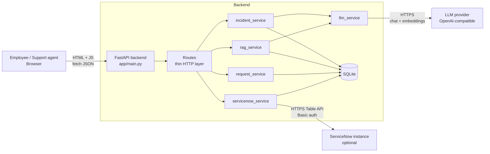
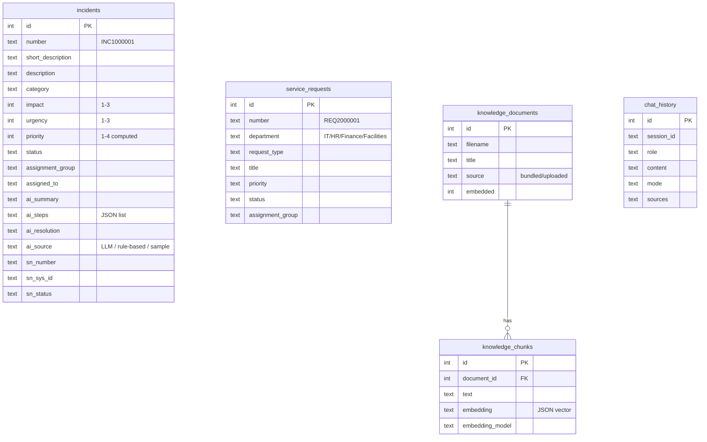
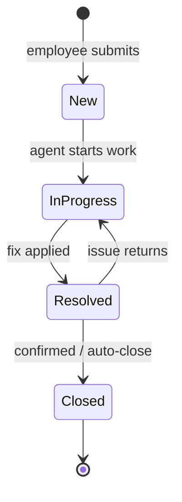
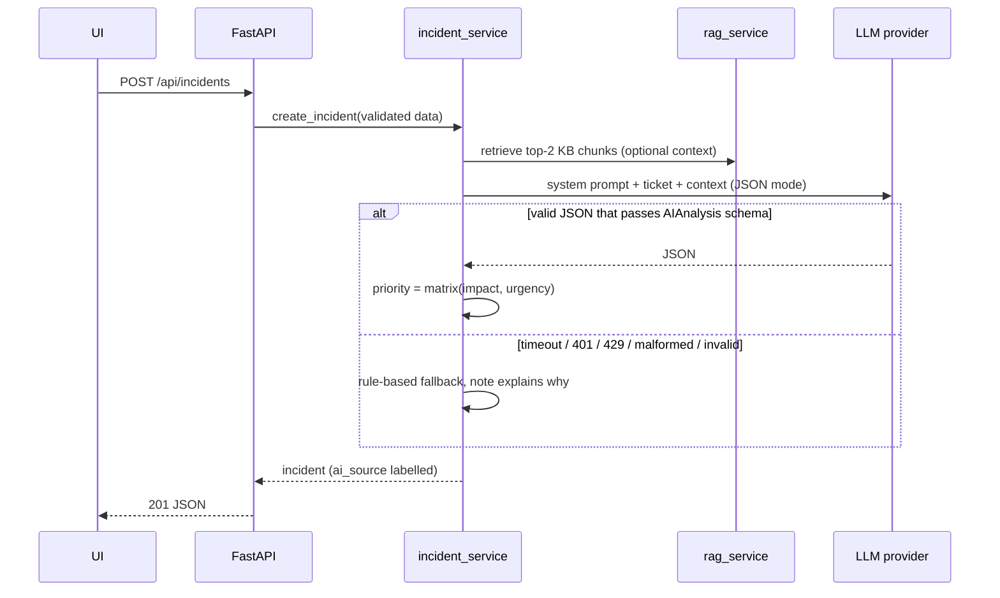
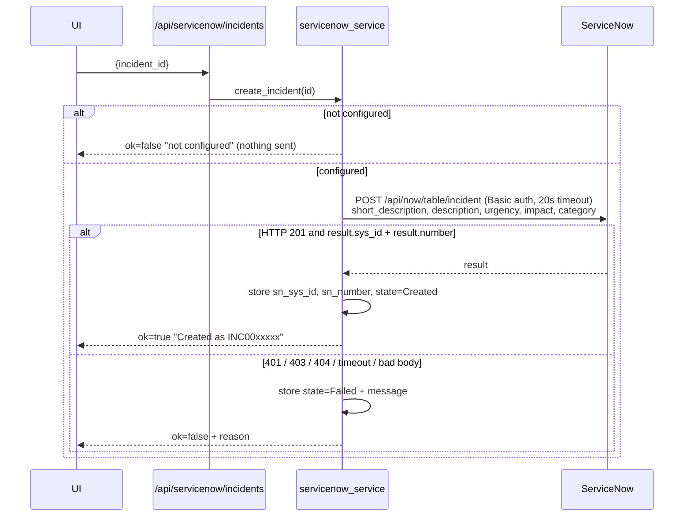

# SmartDesk AI – Architecture

## 1. System overview



Design rule: **routes only validate and delegate; services contain the logic; the database is the only state.**
Each external dependency (LLM, embeddings, ServiceNow) is optional and isolated in one service module, so the app
degrades gracefully when it is unavailable.

## 2. Frontend ↔ backend communication

The frontend is static HTML/CSS/JS served by FastAPI (`StaticFiles`). It calls the JSON API with `fetch()`:

1. Browser loads `/` → `index.html`, `css/styles.css`, `js/app.js`.
2. `app.js` uses a hash router (`#/dashboard`, `#/incidents` …) and renders each page into `<main id="view">`.
3. Each page calls endpoints such as `GET /api/dashboard`; JSON is rendered with an `esc()` helper that HTML-escapes
   every API value (prevents XSS from ticket text).
4. Errors: the `api()` helper converts HTTP errors (including Pydantic 422 messages) into readable toasts/error boxes.

Because the UI and API share one origin (`127.0.0.1:8000`) no CORS configuration is needed in normal use.

## 3. Database design (SQLite)



Tables are created by `init_db()` on startup; sample data by `seed_if_empty()`; knowledge articles by
`load_bundled_knowledge_base()`. All three are idempotent.

## 4. Incident lifecycle



On creation (`incident_service.create_incident`):

1. Pydantic validates the form (`IncidentCreate`).
2. `analyze_incident()` → LLM if a key exists, otherwise rule-based fallback.
3. `calculate_priority(impact, urgency)` – **deterministic matrix, never delegated to the LLM**.
4. Category → assignment group → demo technician.
5. Row saved; number `INC` + (1,000,000 + id) assigned.
6. Optional: user pushes it to ServiceNow.

Priority matrix (`impact + urgency`): 2 = Critical, 3 = High, 4 = Moderate, 5–6 = Low (1=High … 3=Low).

## 5. LLM request flow (incident analysis)



Robustness: `chat_json` retries without `response_format` if the provider rejects JSON mode; `parse_json_object`
strips ``` fences and extracts the first `{…}`; `AIAnalysis` (Pydantic) enforces types/ranges and normalises the
category. Anything that fails becomes a labelled fallback – never a crash or a silent fake.

## 6. RAG pipeline

```mermaid
flowchart TB
    subgraph Indexing["Indexing (on startup / upload / reindex)"]
      D[Document .md .txt .pdf] --> T[extract text]
      T --> C[chunk ~700 chars,<br/>paragraph-aware, 100 overlap]
      C --> E[embedding API<br/>one vector per chunk]
      E --> V[(SQLite<br/>knowledge_chunks.embedding JSON)]
      C -. no key .-> K[(stored text only<br/>keyword search)]
    end
    subgraph Query["Answering a question"]
      Q[Question] --> QE[embed question]
      QE --> SIM[cosine similarity vs all chunks]
      V --> SIM
      SIM --> F{score ≥ threshold?}
      F -- none --> NO[“Knowledge base does not<br/>contain enough information”<br/>LLM NOT called]
      F -- yes --> CTX[build numbered context<br/>top-3, max 2 per doc]
      CTX --> G[LLM: answer ONLY from context,<br/>cite [n], else INSUFFICIENT_CONTEXT]
      G --> A[Answer + sources + excerpts]
    end
```

* **Chunking** keeps passages small enough to be specific and cheap to send; overlap avoids cutting a step in half.
* **Embeddings** map text to vectors so that similar *meaning* is close, even with different words
  ("cannot connect to company network" ≈ "VPN not working").
* **Similarity**: `cosine(a,b) = a·b / (|a||b|)` (see `rag_service.cosine`). Threshold `EMBEDDING_MIN_SCORE` (default 0.30)
  decides "relevant". Below it → honest "not enough information".
* **Context construction**: top chunks are numbered `[1]…` with their document title; the system prompt forbids outside
  knowledge, which is what makes the answer *grounded*.
* **Fallback retrieval** (no embedding key): TF-IDF cosine over stemmed keywords (`_tfidf_scores`). The UI labels it
  *keyword fallback (not semantic)*. If no LLM key: the best passage is returned verbatim and labelled
  *not a generated answer*.
* **Why SQLite, not a vector DB?** A few hundred chunks need only a Python loop; fewer dependencies, no Windows build
  problems. For millions of chunks you would switch to pgvector/FAISS/Chroma – the `retrieve()` function is the only
  place to change.

### Ordinary LLM answer vs RAG answer

| | Plain LLM | RAG (this app) |
|---|---|---|
| Knowledge source | Training data (frozen, generic) | Your current documents |
| Company-specific facts (gateway names, portal URLs) | May be invented (hallucination) | Quoted from your articles |
| Evidence | None | Source titles + excerpts shown |
| When it does not know | Often still answers | Says the KB lacks the information |
| Updating knowledge | Retrain / fine-tune | Upload a document |

## 7. ServiceNow REST integration



Field mapping: `urgency`/`impact` use the same 1–3 scale; our category maps to ServiceNow's choice values
(`Network→network`, `Hardware→hardware`, `Software→software`, `Access/Other→inquiry`). URL must be `https://…`
(plain `http` only for localhost). Credentials come from `.env`, are sent only in the Basic-auth header, and are
never returned by any endpoint or included in error text.

## 8. Error handling summary

| Failure | Behaviour |
|---|---|
| Invalid input | Pydantic → HTTP 422 with field messages |
| No LLM key | Rule-based triage / extractive answer, clearly labelled |
| LLM 401/429/timeout/network | `LLMError` with safe message → fallback + note in UI |
| LLM returns bad JSON / wrong schema | Rejected by `AIAnalysis` → fallback |
| Embedding failure | Keyword retrieval + note |
| No relevant chunk | "Knowledge base does not contain enough information" – LLM not called |
| ServiceNow not configured / 401 / 403 / 404 / timeout | `ok=false` + message; local incident marked, never "created" |
| SQLite error | Global handler → HTTP 500 with generic message (details only in server log) |
| Too many requests / huge body | HTTP 429 / 413 |

## 9. Security notes (demo level)

Secrets only in `.env` (git-ignored) · parameterised SQL everywhere (no string-built user input) · output escaping in the
UI · upload type/size limits · in-memory rate limiting (per IP, single process) · no real authentication
(demo user) – a real deployment needs SSO/OAuth, roles, HTTPS, audit logs and a managed database.
